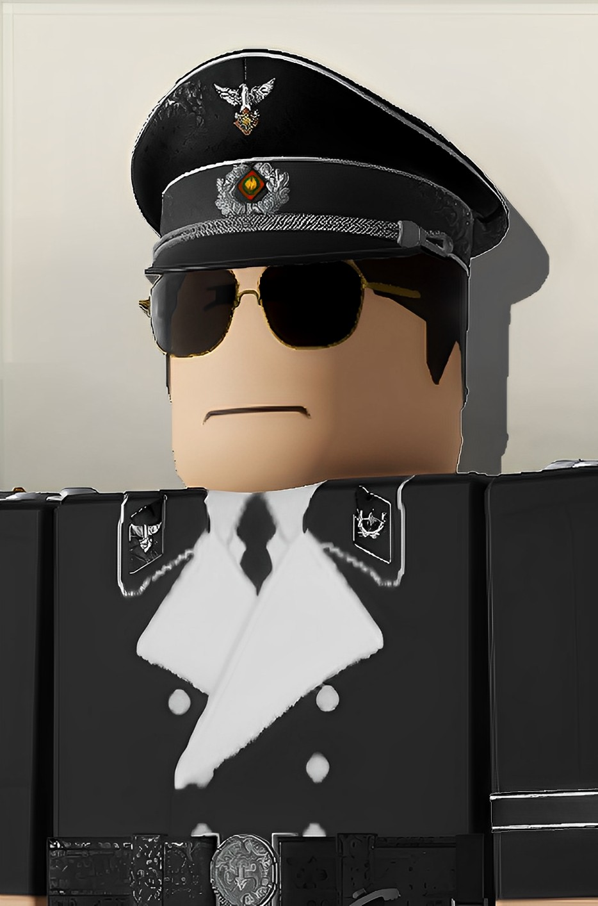

    

# Description

Portrait of 1. OT Legate Commandant, **Victor Eulenberg**.
Colloquially known as the **Stellvertretender OT-Troopsmarshal**.

This version was created after the second version has been moderated
for including the **Iron Cross** medal.

The render is done with the works of AI image enhancer and
Photopea's `Oil Paint` filter.
