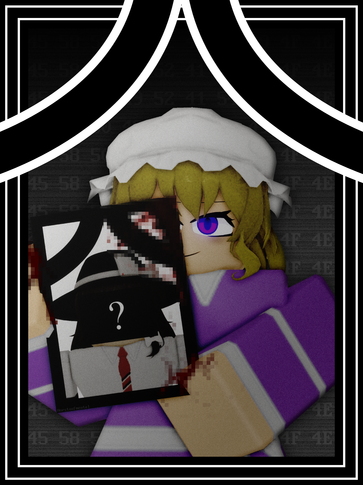

    

# Description

A render largely based off [Sleepwalk_zzz's work](https://x.com/Sleepwalk_zzz/status/1886065774588297728).
The idea was to replicate the major design of the work, however,
the issue came when dealing with the minor decor for the background,
which I do not have samples of or even where to look for them.
I decided to improvise on my own, keeping it relatively simple.

The sequence of hexadecimal digits on the background, when combined together forms:

`45 58 50 49 52 41 54 49 4F 4E`

A hexadecimal sequence of ASCII characters, when converted back to
regular charcters turns into:

`E X P I R A T I O N`

The name of this render piece.
The word here refers to **Renko Usami** pictured in a funeral picture frame,
as its being carried by **Maribel Hearn**, also being encased in
another funeral picture frame.

It could be interpreted in more than one way, and I'm not
going to judge whether your thought is wrong or not.

One could give it more detailed reasoning, while one may simply just says
`"yuri gotten out of hand"`. That works too, because I am that "one".
