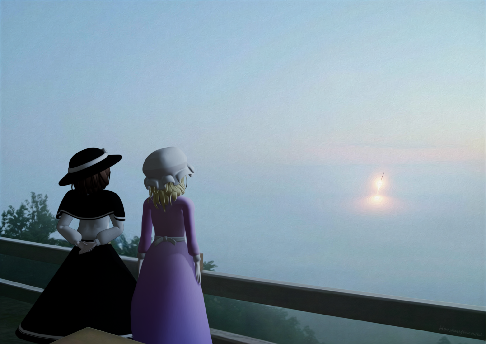
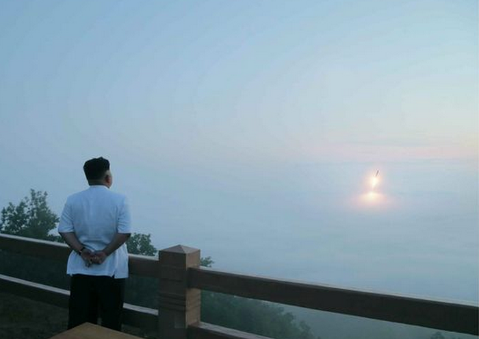

    

# Description

A render that I used as my reference for an "impressionism" arts assignment,
the assignment never ended up being finished because of busy schedule, nonetheless
this is the first time I've done a render in Blender after years and it turned
out quite fine.

Original Reference:

    

Models used:

- [Renko Usami](https://bowlroll.net/file/311976)
- [Maribel Hearn](https://bowlroll.net/file/303754)