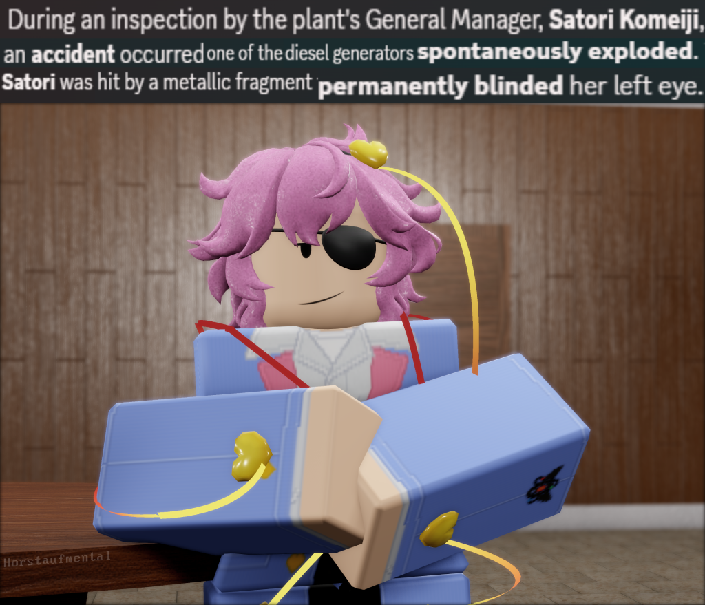

    

# Description

During an inspection by the plant's General Manager, **Satori Komeiji**,
an **accident** occurred when one of the emergency diesel generators **spontaneously
exploded**. While no serious casualties have been reported, Satori was reportedly
hit by a metallic fragment that **permanently blinded** her left eye.
**All maintenance personnel** involved have been **relieved of their positions**,
and their supervisor has been **reprimanded**.

Based off the famous picture of then **Chancellor of Germany**, **Olaf Scholz**
wearing an eyepatch following a jogging accident.

    

